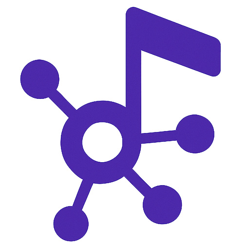

<p align="center">
  
</p>

<h1 align="center">SoundBuddy</h1>

<p align="center">Conectando músicos, produtores e contratantes para criar em conjunto.</p>

O SoundBuddy é uma plataforma de conexões musicais: músicos, produtores e contratantes podem descobrir pessoas, conhecer seus trabalhos e organizar propostas para novos projetos.

## Landing page

Clique na imagem para abrir a landing page do projeto.

[](https://jambotechufpb.github.io/SoundBuddy/)

## Demo da plataforma

A prévia percorre rapidamente a plataforma em `/app/`: busca e filtro de músicos, perfil salvo, oportunidades e criação de uma proposta.


Os perfis e briefings são fictícios. A demo não envia mensagens, não autentica usuários e não usa a API nem o MongoDB. Perfis salvos e propostas ficam apenas no navegador via `localStorage`.

## Arquitetura do projeto

| Pasta | Responsabilidade |
| --- | --- |
| [`landing-page/`](landing-page/) | Landing page estática e assets publicados na raiz do site |
| [`frontend/demo/`](frontend/demo/) | Demo estática publicada em `/app/`; salvos e propostas usam `localStorage` |
| [`frontend/`](frontend/) | Aplicação Next.js integrada à API local |
| [`backend/`](backend/) | API Express e modelos MongoDB |
| [`docs/`](docs/) | Relatórios e documentação do projeto |

## Como contribuir

1. Atualize a branch de desenvolvimento:

   ```bash
   git checkout dev
   git pull origin dev
   ```

2. Crie uma branch para sua alteração:

   ```bash
   git checkout -b <id-descricao-simples-da-task>
   ```

   Exemplo: `git checkout -b 7-adicionar-notificacoes`.

3. Abra um Merge Request para `dev` após concluir a alteração. Não envie diretamente para `main`.

### Padrão de commits

Use mensagens curtas no formato `tipo: descrição`:

```bash
git commit -m "feat: adiciona sistema de notificações"
```

Tipos comuns: `feat`, `fix`, `docs`, `test`, `build`, `style`, `refactor` e `chore`.

## Executar localmente

### Demo estática

Para servir a landing page e a demo estática:

```bash
mkdir -p /tmp/soundbuddy-site/app
cp -R landing-page/. /tmp/soundbuddy-site/
cp -R frontend/demo/. /tmp/soundbuddy-site/app/
python3 -m http.server 8080 --directory /tmp/soundbuddy-site
```

Abra `http://localhost:8080/`. O fluxo [`.github/workflows/pages.yml`](.github/workflows/pages.yml) publica o site no GitHub Pages em pushes para as branches configuradas ou por execução manual.

### Aplicação local

Suba os serviços localmente:

```bash
docker compose --env-file .env.local up --build
```

Para expor a aplicação à rede local:

```bash
docker compose --env-file .env.expose up --build
```

Encontre o IP da máquina com `hostname -I`.
